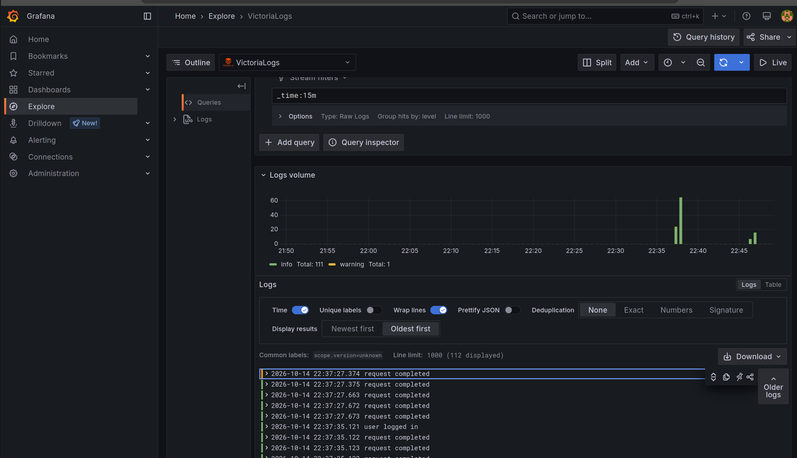

# Отчёт 3

## Victoria Logs в Minikube

В том же namespace `spaceship`, что и приложение, развёрнут Victoria Logs: Deployment + Service + PVC (`deploy/k8s/victoria-logs.yaml`). Образ `victoriametrics/victoria-logs:v1.53.0`, порт `9428`, данные на томе `1Gi'. Снаружи UI открывается так:

```bash
kubectl -n spaceship port-forward svc/victoria-logs 9428:9428
```

vmui: http://localhost:9428/select/vmui

---

## JSON-логи приложения

Order и IAM пишут Zap в stdout в JSON. В ConfigMap включено `LOGGER_AS_JSON: "true"`. Поля: `timestamp`, `level` / `severity_text`, `message` (`_msg`), `service.name` (`order-service` / `iam-service`), плюс `http.method`, `http.path`, `http.status`, `caller`. Прообы в логи не отправляются, чтобы не забивать вывод

---

## Доставка логов

Выбран OpenTelemetry Collector, а не DaemonSet Vector и не sidecar

Приложение уже умело `LOG_OUTPUTS=stdout,otlp` (Zap → OTLP/gRPC на `:4317`) и чтобы переиспользовать уже имеющийся код, достаточно было переписать логику OTLP. Victoria Logs принимает OpenTelemetry только по HTTP (`/insert/opentelemetry/v1/logs`), поэтому коллектор - мост 


```text
order / iam  →  JSON stdout
             →  OTLP/gRPC  otel-collector:4317
                              ↓  OTLP/HTTP
                       victoria-logs:9428
                              ↓
                       vmui / Grafana
```

Манифест коллектора: `deploy/k8s/otel-collector.yaml`. В ConfigMap сервисов: `LOG_OUTPUTS: stdout,otlp`, `OTEL_COLLECTOR_ENDPOINT: otel-collector:4317`. Init-контейнеры ждут коллектор, чтобы приложение не стартовало в пустоту

---

## LogsQL в vmui

### (а) Сырые записи за последние 15 минут

```text
_time:15m
```

Все логи Order и IAM за окно. Видны сообщения request completed, order created, order paid. В раскрытой записи — _msg, _stream с service.name, _time


### (б) Фильтр по полю

```text
_time:15m service.name:order-service
```

Только Order. На скрине после создания и оплаты заказа есть order created и order paid, без инфы по IAM

<!-- вставить скрин vmui -->

### (в) Stats с группировкой

```text
_time:15m | stats by (service.name) count() logs
```

Сколько записей у каждого сервиса (на скрине order-service — 19, iam-service — 16). В vmui включён Stats view: легенда графика показывает группы

<!-- вставить скрин vmui -->

### (г) Агрегат: top по пути

```text
_time:15m | stats by (http.path) count() hits | sort by (hits desc) | limit 10
```

Самые частые HTTP-пути. На скрине лидирует /api/v1/auth/whoami (UI проверяет сессию), дальше /api/v1/orders и /api/v1/parts

<!-- вставить скрин vmui -->

---

## Бонус: Grafana

В кластере Grafana (deploy/k8s/grafana.yaml) с официальным плагином. Datasource смотрит на `http://victoria-logs:9428`. Плагин по умолчанию ищет поле level, у OTLP уровень в severity_text — в jsonData заданы log level rules и OpenTelemetry preset

```bash
kubectl -n spaceship port-forward svc/grafana 3000:3000
```

http://localhost:3000 — admin / admin. Explore -  Victoria Logs, те же запросы, что в vmui

(здесь данные отличаются, потому что я Grafana плагин потом поставил и уже другие логи смотрел)


