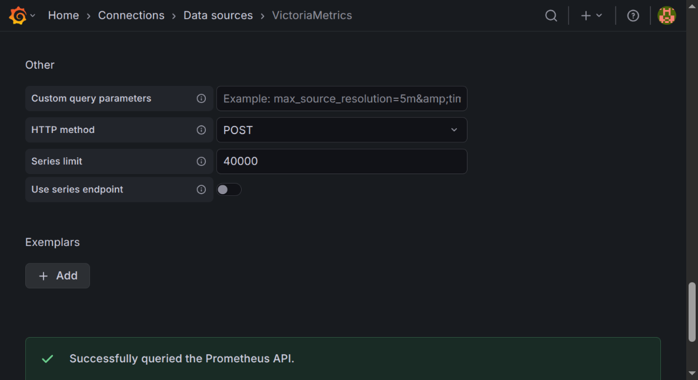
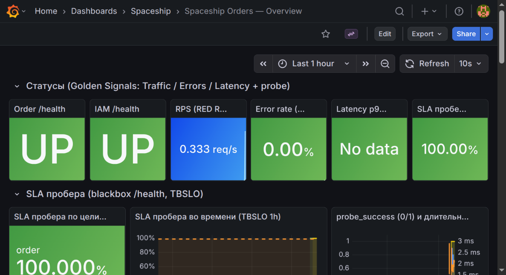
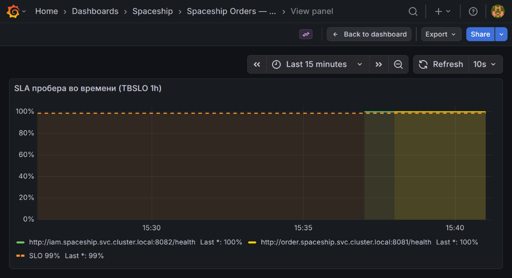
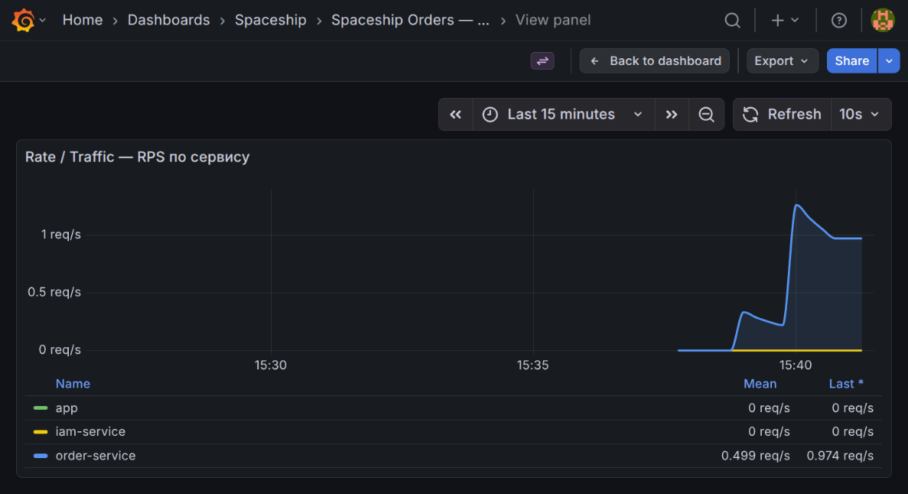
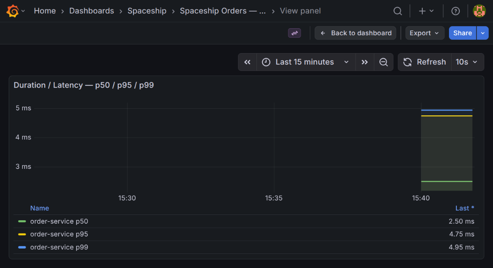
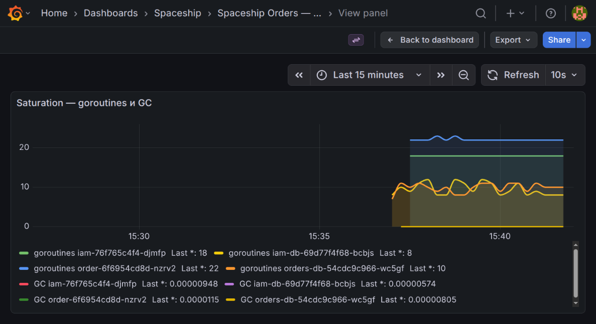
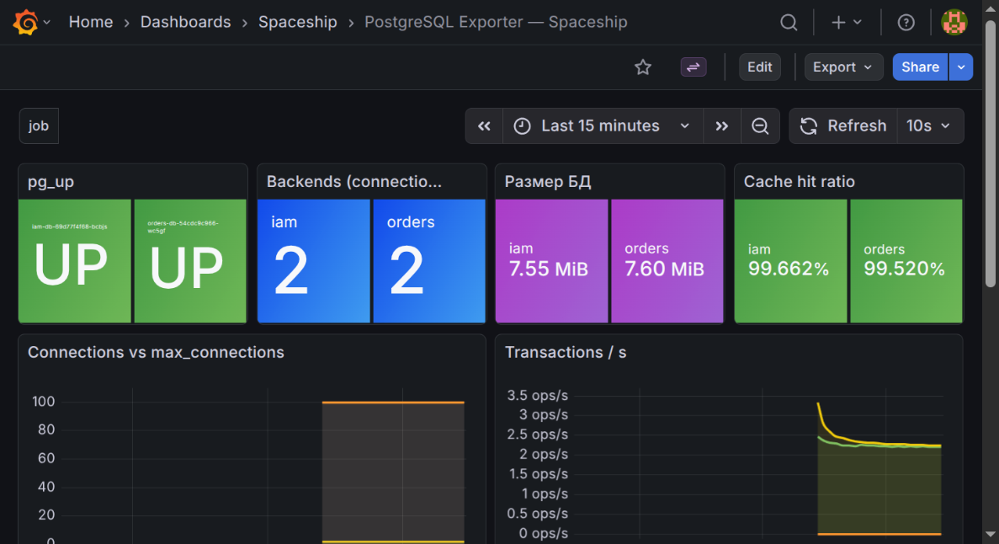
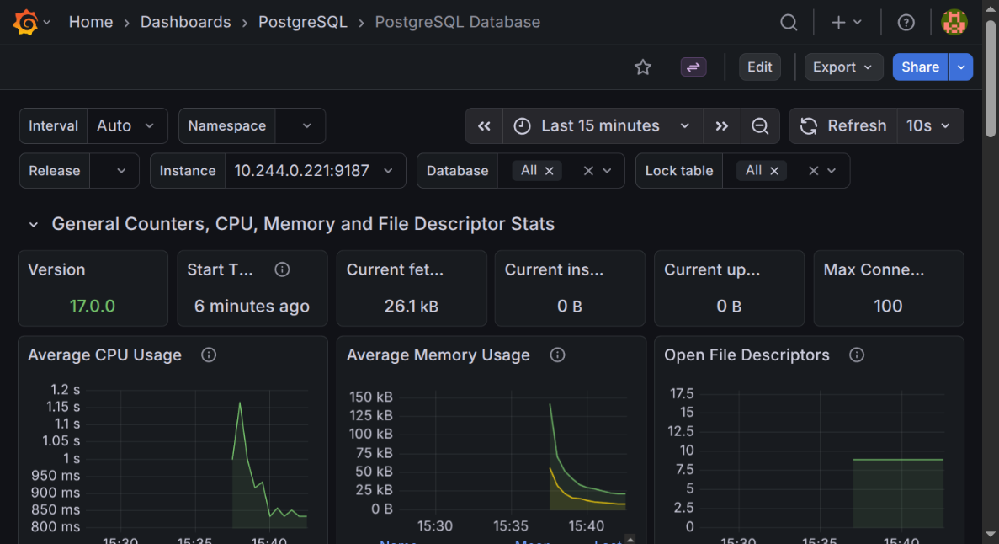

# Отчёт 6. Grafana: дашборд приложения, SLA пробера, PostgreSQL Exporter

Задание: Grafana в minikube, datasource VictoriaMetrics, панели состояния приложения (RED / USE / Golden Signals), отдельная панель SLA пробера, импорт дашборда PostgreSQL Exporter.

Код сервисов не менялся. Новое — Grafana в `monitoring` и JSON дашбордов.

## Как запущено

Namespace `monitoring`. Chart `grafana/grafana` (репозиторий из текста ДЗ `grafana-community` — тот же chart).

```bash
helm repo add grafana https://grafana.github.io/helm-charts
helm repo update
kubectl create namespace monitoring --dry-run=client -o yaml | kubectl apply -f -
kubectl apply -k deploy/grafana
helm upgrade --install grafana grafana/grafana -n monitoring --create-namespace \
  -f deploy/k8s/monitoring/grafana-values.yaml
kubectl -n monitoring port-forward svc/grafana 3000:80
```

UI: http://localhost:3000 · `admin` / `admin`.

Datasource **VictoriaMetrics** (тип Prometheus): `http://vm-single-victoria-metrics-single-server.monitoring.svc:8428`, POST, interval 15s. Не Victoria Logs `:9428` и не vmalert `:8880`. Grafana в `spaceship` из ДЗ 3 остаётся для логов.

JSON приложения: `deploy/grafana/dashboards/spaceship-overview.json` (артефакт). Postgres: `postgres-exporter.json` + скачивание grafana.com **9628**.

## Источник данных

VictoriaMetrics Single (`vm-single`, scrape 15s, job `kubernetes-pods` + `blackbox-health`). Ряды:

- приложение `:9090` — `http_*`, `orders_*`, `iam_*`, `go_*`, `process_*`;
- blackbox — `probe_success`, `probe_duration_seconds`;
- postgres-exporter `:9187` — `pg_*`.

## Панели приложения (6 баллов)

Методологии на одном экране: **RED** (Rate, Errors, Duration) для HTTP; **Golden Signals** (+ Saturation); **USE** (Utilization, Saturation, Errors) для рантайма Go.

| Панель | Метрики / запрос | Почему |
|--------|------------------|--------|
| Order / IAM `/health` | `probe_success{instance=~".*order\|iam.*"}` | Статус снаружи, как видит пробер |
| RPS | `sum(rate(http_requests_total[5m]))` | RED Rate / Traffic |
| Error rate | доля `code=~"5.."` | RED Errors / Errors |
| Latency p95 | `histogram_quantile(0.95, …_bucket)` | RED Duration / Latency |
| Rate по сервису | `sum by (service) (rate(http_requests_total[5m]))` | Order vs IAM |
| Errors | 5xx, `orders_create_failed_total`, `iam_logins_total{result="fail"}` | Бизнес-ошибки рядом с HTTP |
| p50/p95/p99 | histogram | Хвост latency |
| CPU | `rate(process_cpu_seconds_total[5m])` | USE Utilization |
| RSS / heap | `process_resident_memory_bytes`, `go_memstats_heap_inuse_bytes` | USE Utilization; алерт ДЗ 5 |
| Goroutines / GC | `go_goroutines`, `rate(go_gc_duration_seconds_sum[5m])` | USE Saturation / Golden Saturation |
| SLI-1…3 и SLA app | запросы из ДЗ 4, окно **1h** | Связь со SLO; 7d на стенде не двигается |
| Заказы / логины / выручка | `orders_*`, `iam_logins_total` | Объём, не доступность |

Верхний ряд — «горит ли сервис», ниже — разбор, ещё ниже — рантайм. Job у pod-scrape — `kubernetes-pods`, фильтр рантайма `{namespace="spaceship"}`.

Окно графиков **Last 1 hour**, refresh **10s**. `DEMO_FAULT=create_fail` двигает Errors и SLI-1, не `probe_success`.

## SLA пробера (3 балла)

Отдельный ряд панелей, не SLA приложения `(SLI_create + SLI_login + SLI_http) / 3`.

Синтетика blackbox GET `/health` → 200 (`deploy/k8s/blackbox.yaml`). SLI — доля минут, когда проба успешна (TBSLO):

```
avg_over_time((probe_success == 1)[1h:1m])
```

SLO: ≥ 99%. Stat — текущее значение по Order/IAM; timeseries — то же + `vector(0.99)`; рядом сырой `probe_success` 0/1 и `probe_duration_seconds`.

На определении SLO окно 7d; на стенде **1h**, иначе график плоский. `DEMO_FAULT` `/health` не ломает. Для демо:

```bash
kubectl -n spaceship scale deploy/order --replicas=0
# SLA order падает; затем --replicas=1
```

## PostgreSQL Exporter (1 балл)

Sidecar exporter на `orders-db` / `iam-db`, порт 9187, scrape по аннотациям.

1. Свой дашборд `PostgreSQL Exporter — Spaceship` (`postgres-exporter.json`): `pg_up`, backends, size, cache hit, xact, tuples. Job зашит как `kubernetes-pods` (у 9628 по умолчанию `postgres` — панели были бы пустые).
2. Helm скачивает **9628** (PostgreSQL Database) в папку Grafana `PostgreSQL`. В переменных дашборда выставить **job =** `kubernetes-pods`.

## Скриншоты

Каталог `deploy/grafana/screenshots/`.



Datasource: тип Prometheus, URL VM `:8428`, POST. Save & test: «Successfully queried the Prometheus API».



Верхний ряд: Order/IAM UP, RPS, error rate 0%, SLA пробера 100%. Ниже — TBSLO пробера по целям и график с линией SLO 99%.



Отдельная панель: `avg_over_time((probe_success == 1)[1h:1m])` для Order и IAM, оба 100% при живых `/health`.





Traffic ~1 req/s на order-service после нагрузки на UI; p50/p95/p99 в миллисекундах.



Saturation: `go_goroutines` и GC. На графике также postgres-exporter (тот же collector Go) — для алертов ДЗ 5 смотреть поды `order`/`iam`.



`pg_up=1` у iam и orders, backends, размер БД, cache hit > 99%.



Импорт grafana.com 9628 PostgreSQL Database: Postgres 17.0.0, instance :9187, CPU/memory exporter, max_connections 100. На этой ревизии переменные Namespace/Instance, не старый postgres
